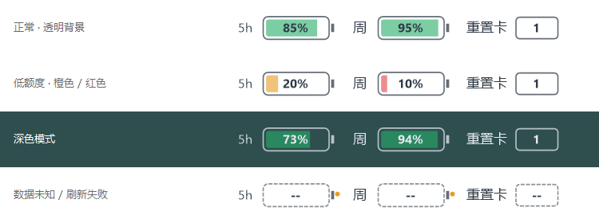

# Codex Quota Battery · Codex 额度电池条

在 Windows Codex 顶部“帮助”菜单右侧，用透明手机电池显示 **5小时、每周剩余额度**，同时显示 **重置卡库存**。

[English](README.en.md) · [下载发布版](https://github.com/xiaoxuw/codex-quota-battery/releases/latest) · [详细使用说明](使用说明.md) · MIT



> 图中数字为样式演示，不是当前账户的实时额度。背景透明，深色行展示深色主题效果。

## 功能

- 两个电池分别显示5小时、每周的剩余百分比，填充长度随剩余额度变化。
- 剩余量大于20%为绿色，10%～20%为橙色，10%及以下为红色。
- 重置卡显示官方返回的可用库存，只读展示，不自动使用重置卡。
- 悬停查看重置时间、倒计时和上次更新时间。
- 通过 Codex 本地插件机制加载；连接关闭或最后一个 Codex 窗口关闭后退出。最小化时隐藏。
- 不设置 Windows 登录启动，不修改 Codex 本体或快捷方式。

## 是否与 Codex 的用量同步？

数据读取自官方本地 Codex App Server 的 `account/rateLimits/read`。电池显示的是 **账户剩余额度**，即 `100 - usedPercent`，不是当前聊天的上下文占用或剩余 token。

默认 **每60秒刷新一次**，也可双击托盘图标或选择“立即刷新”。随着账户额度消耗，下一次刷新后百分比和电池填充会相应减少。官方额度统计与页面刷新可能存在延迟，因此不保证逐秒一致。额度重置后，以官方新返回值为准。

读取失败时保留上次成功值，并用虚线/橙点标记；未知值显示 `--`，不会伪装成100%或0%。

## 安装发布版（Windows x64）

1. 从 [Releases](https://github.com/xiaoxuw/codex-quota-battery/releases/latest) 下载 `CodexQuotaBattery-v1.1.1-win-x64.zip`。
2. 解压到长期保留的目录。不要只复制 EXE，也不要安装后删除该目录。
3. 在解压目录打开 PowerShell，运行：

```powershell
powershell -File .\install-plugin.ps1
```

4. 完整退出并重新打开 Codex 一次。之后由 Codex 加载插件，无需单独启动电池条。

插件标识：`codex-quota-battery@codex-quota-tools`。可在 Codex 插件设置中禁用或卸载。需要安装当前官方 Codex，并使用 ChatGPT 账户登录；安装脚本需要可用的 `codex` 命令。发布版自带 .NET 运行时，无需安装 SDK。

## 从源码构建

需要 Windows x64、.NET 10 SDK 和官方 Codex：

```powershell
git clone https://github.com/xiaoxuw/codex-quota-battery.git
cd codex-quota-battery
powershell -File .\build-batteries.ps1
powershell -File .\install-plugin.ps1
```

## 验证

发布版已通过34项额度/绘制/生命周期检查和297项上游检查，并验证 MCP 连接关闭后的进程退出、多连接显示接管、官方本地额度读取。

```powershell
.\dist\CodexQuotaBattery.exe --quota-test quota-tests.json
.\dist\CodexQuotaBattery.exe --self-test .\fixtures
pwsh -File .\tests\verify-plugin.ps1
pwsh -File .\tests\verify-mcp-failover.ps1
```

Windows 图形程序在自动化脚本中应显式等待退出再检查退出码。

## 兼容性与隐私

- 仅支持 Windows 10/11 x64。本工具是透明附着窗口，通过本地 MCP 插件管理进程，并非 Codex 官方提供的工具栏扩展 API。
- 当前自定义“帮助”菜单无法通过原生菜单读取时，使用按 DPI 缩放的实测相对位置。Codex 顶部布局变化后可能需要适配；窗口太窄时隐藏。
- 最后一个 Codex 窗口关闭后有约2～3秒的窗口重建宽限期；插件通信连接断开时直接退出。
- 官方本地接口和客户端插件加载机制可能随版本变化。安装后需在自己的客户端验证加载效果。
- 额度入口不读取登录令牌文件或聊天内容，不调用推理模型；仅让官方程序使用自身登录状态查询账户额度。
- 本机状态文件在 `%LOCALAPPDATA%\CodexQuotaBattery\status.json`，包含额度和窗口状态。请勿将实际账户状态或本机日志提交到公开仓库。

## 来源与许可

本项目基于 [dongyue-19/codex-statusbar](https://github.com/dongyue-19/codex-statusbar)（上游基线 `17f0ddd25512b9a823b56a37da325d36ca53971f`），复用其 Codex 窗口识别、窗口采样及透明叠加基础。新增账户额度电池、重置卡库存与 Codex 托管的插件生命周期。

保留 [LICENSE](LICENSE)、[LICENSE-codex-token-overlay](LICENSE-codex-token-overlay) 和 [THIRD-PARTY-NOTICES.md](THIRD-PARTY-NOTICES.md)。上游 Token 状态条源码保留作基础参考，发布 EXE 的运行入口是额度电池条。

独立社区项目，非 OpenAI 官方产品。Codex、ChatGPT、OpenAI 名称及商标属于其各自权利人。
